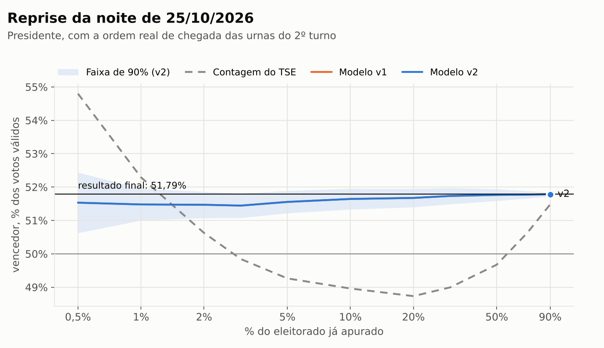
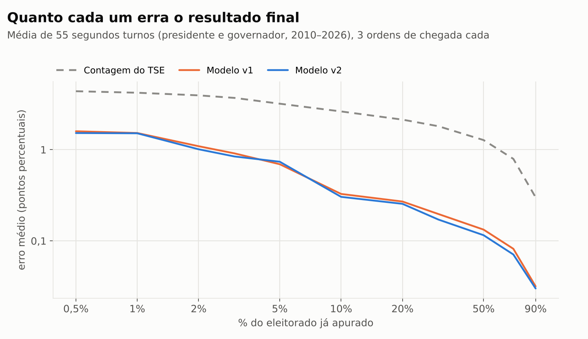
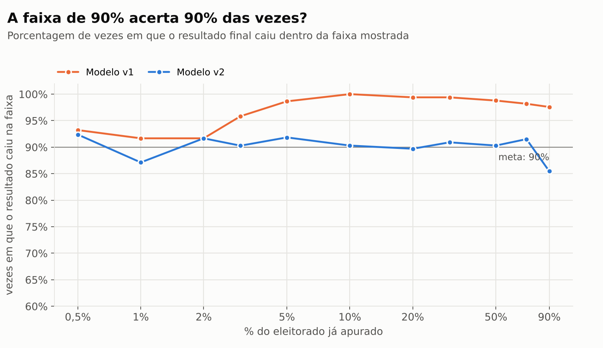
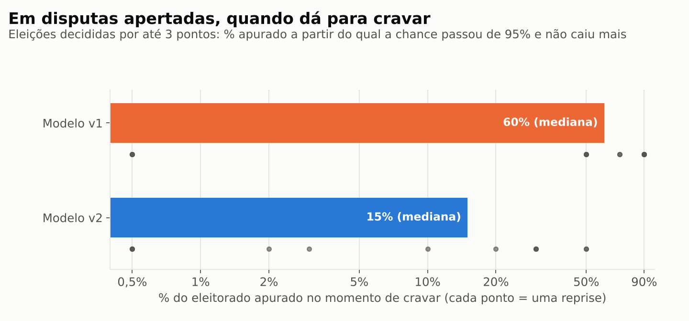
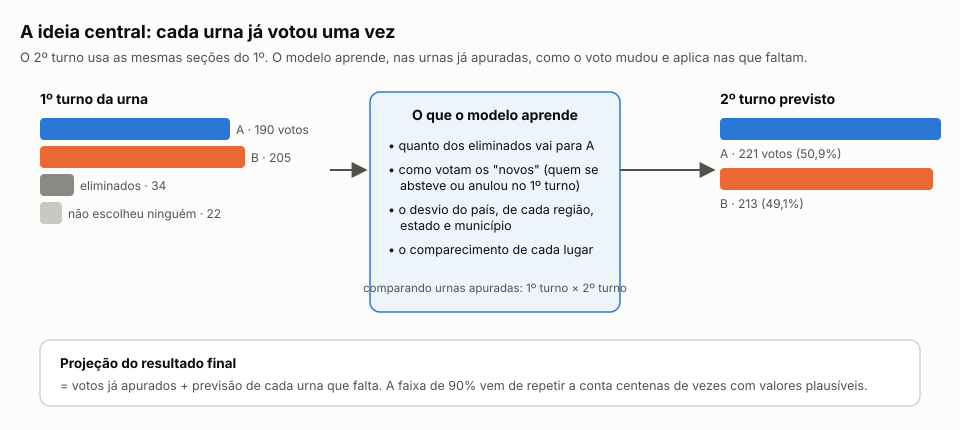
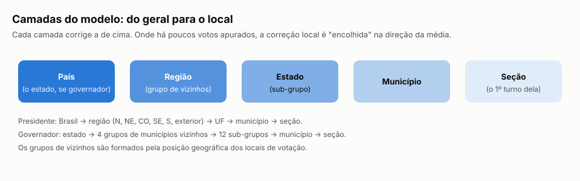
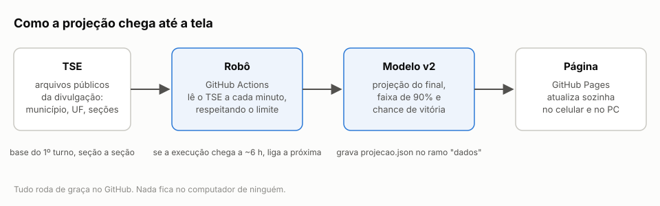

# Projeção eleitoral · 2º turno

Um modelo que acompanha a apuração de um 2º turno, de presidente ou de governador, e mostra a
cada minuto **para onde o resultado está indo**: a projeção do resultado final, uma faixa de
90% e a chance de vitória de cada candidato. Tudo com dados públicos do TSE, rodando de graça no
GitHub.

*Reprise da noite do 2º turno de 2026, com a ordem real de chegada das urnas: a contagem do TSE
chegou a mostrar à frente o candidato que perderia; a projeção v2 ficou entre 51,4% e 51,8% do
começo ao fim, e o resultado final foi 51,79%.*

## Em números

Teste em **55 segundos turnos** de 2010 a 2026 (5 de presidente, 50 de governador),
cada um apurado de novo, urna por urna, em 3 ordens de chegada realistas. A versão 2 (v2) é
comparada com a versão que rodou ao vivo em 25/10/2026 (v1) e com a contagem bruta do TSE.

| | Contagem do TSE | v1 | **v2** |
|---|---|---|---|
| Erro médio, com 10% apurado | 2,62 pontos | 0,33 pontos | **0,30 pontos** |
| Erro médio, com 30% apurado | 1,81 pontos | 0,20 pontos | **0,17 pontos** |
| Aponta o vencedor certo (todos os momentos) | 89,1% | 99,0% | **99,2%** |
| A faixa de 90% contém o resultado | — | 97% (larga demais) | **90%** |
| Largura da faixa com 10% apurado | — | 4,0 pontos | **1,6 pontos** |
| Erro da chance de vitória (Brier, menor é melhor) | — | 0,0117 | **0,0064** |
| Chamadas erradas (> 95% para quem perdeu) | — | 0 | **0** |
| Disputas apertadas: % apurado para cravar (mediana) | — | 60% | **15%** |

O que mais melhorou foi a **honestidade da incerteza**. A projeção central já era boa na v1 e
ficou um pouco melhor (até 13% menos erro). A faixa, porém, ficou de 2 a 3,5 vezes mais estreita a partir de uns 5% apurado, sem
perder confiabilidade, e o erro da chance de vitória caiu quase pela metade. Em disputas
decididas por até 3 pontos, a v2 pôde cravar o vencedor com uma mediana de 15% apurado, contra
60% da v1, sem nenhuma chamada errada.

**Teste fora da amostra (2026).** Nada de 2026 foi usado para ajustar a v2. Nas 6 eleições de
2026, a chance de vitória teve Brier 0,0168 (v1) contra **0,0065** (v2). Exemplo: no
governo do Rio Grande do Norte, decidido por 50,77% a 49,23%, com 30% apurado a v2 dava
99,9% de chance ao vencedor; a v1, 75%.

Tabelas completas por cargo e por estágio: **[docs/resultados.md](docs/resultados.md)**.

## Como funciona

O 2º turno usa as mesmas seções eleitorais do 1º turno. Para cada uma das ~500 mil urnas
sabemos como ela votou três semanas antes. Quando uma urna é apurada, o modelo compara o 2º
turno com o 1º turno **da mesma urna** e aprende para onde foram os eleitores dos candidatos
eliminados e quanto cada região e município se moveu. Depois aplica isso a cada urna que ainda
falta. A incerteza vem de centenas de sorteios, ajustados por uma fórmula calibrada nas eleições
passadas.

Explicação completa, com as fórmulas: **[docs/como-funciona.md](docs/como-funciona.md)**.
A história do projeto: **[docs/como-construimos.md](docs/como-construimos.md)**.

## Como usar

O robô em funcionamento fica no repositório
[Drill23/projecao-2026](https://github.com/Drill23/projecao-2026), desligado até ser chamado:

1. criar a configuração da eleição (`codigo/eleicoes/modelo-presidente.json` ou
   `modelo-governador.json`);
2. *Preparar base*: monta o 1º turno por seção a partir dos dados abertos do TSE;
3. *Ensaio*: testa o robô com os arquivos do 1º turno, sem publicar nada;
4. *Apuração ao vivo*: no dia, publica a projeção a cada minuto numa página do GitHub Pages.

## Repositório

| Pasta | Conteúdo |
|---|---|
| `codigo/projecao/` | modelo v2 (`modelo_v2.py`), carga da base (`base.py`) e o v1 original (`modelo.py`) |
| `codigo/scripts/` | robô, preparo da base, dados históricos, reprise e estatísticas, gráficos |
| `codigo/pagina/` | a página (um único HTML) |
| `codigo/eleicoes/` | configurações de exemplo |
| `codigo/exemplos-github-actions/` | as automações usadas (copie para `.github/workflows/` para ativar) |
| `resultados/` | resultados brutos da avaliação e a calibração |
| `docs/`, `img/` | documentação e ilustrações |

## Limitações

- É uma **projeção não oficial**. O resultado que vale é o do TSE.
- O Distrito Federal tem um único município e não pode ser projetado por município.
- O teste usa os dados finais por seção; atrasos e falhas dos arquivos do TSE durante a
  apuração real não aparecem nele.
- Só 4 das eleições testadas foram decididas por até 3 pontos.

Dados: Tribunal Superior Eleitoral (resultados da divulgação e dados abertos).
Feito por Adriano, com o Claude (Anthropic). Licença MIT.
